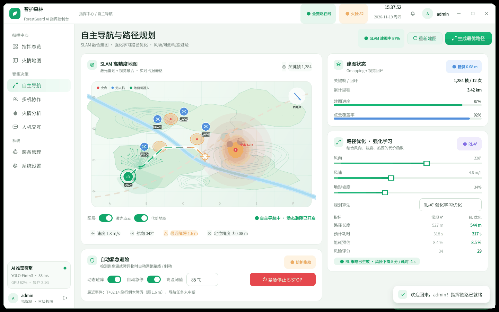
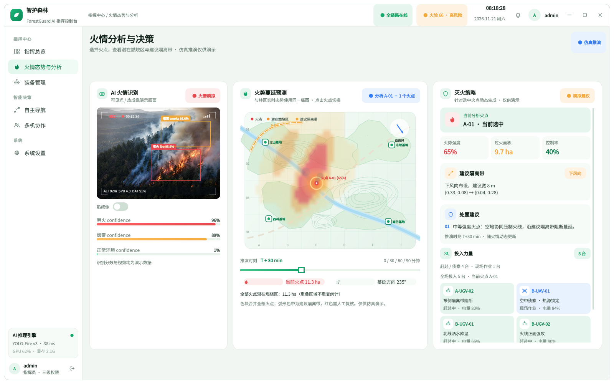

# 智护森林 · ForestGuard AI

基于 PySide6 / Qt 的森林防火空地协同**仿真演示**。系统把巡逻、火情发现、自动调度、路径规划、扑救和装备休整串联在同一界面中，用于交互和算法流程展示。

> **安全提示：不是实际防灭火系统。** 火情识别、图像、火势预测、地形、轨迹、装备状态和协同均为模拟或示意；未接入真实传感器、飞控或经过验证的 AI 模型。不得用于真实作战、飞行或安全决策。部分页面上的指标、模型和链路控件仅为界面演示。

## 界面预览

以下截图来自当前仿真界面，火情和装备数据仅为演示。不同窗口尺寸下布局可能有所变化。

| 登录 | 指挥总览 |
| --- | --- |
|  |  |

| 自主导航 | 多机协作 |
| --- | --- |
|  |  |

| 火情分析 | 装备管理 |
| --- | --- |
|  |  |

| 系统设置 | 遥控终端（仿真） |
| --- | --- |
|  |  |

遥控终端还可查看[红外模式](docs/screenshots/11-remote-ir.png)和[断链状态](docs/screenshots/12-remote-offline.png)。

## 快速开始

需要 Python 3.10+、图形桌面环境及 Qt 所需系统图形库。

```bash
git clone https://github.com/Bevis-nb/ForestGuardAI-System.git
cd ForestGuardAI-System
python -m venv .venv
# Linux / macOS
source .venv/bin/activate
# Windows PowerShell 使用：.venv\Scripts\Activate.ps1
python -m pip install -r requirements.txt
python main.py
```

- 演示账号：`admin` / `admin`；也可以在登录页注册本地账号。账号数据位于 `utils/user_data.csv`，请勿使用真实密码或将真实账号信息提交到仓库。
- 登录后开始演练：两架无人机先从基地出发巡逻；登录约 10 秒后启用随机起火。退出后停止演练，重新登录会重置状态。
- 仿真默认每秒推进一次，可通过设置调整刷新间隔，并可使用总览页倍速控制。仿真时间和真实物理时间不等价。
- Linux 如出现 `libGL.so.1`、`libEGL.so.1`、`libxkbcommon.so.0` 或 Qt 平台插件加载错误，需要安装发行版提供的相应图形库及其依赖。无桌面或缺少图形库时无法启动界面。

## 慢速自动演示

安装依赖后运行 `python demo_autoplay.py`。脚本展示登录页约 3 秒后自动以演示账号登录，以 1× 速度依次展示巡逻、自动起火、自主导航、多机协作、火情分析、装备管理和总览；各页面停留约 15～25 秒。火点和喷水等状态均由仿真自然产生，不强制设备瞬移、喷水或扑灭，无法保证在演示期间扑灭火点。演示结束后仿真继续运行；关闭窗口或退出登录会停止自动切页。此脚本仍需要图形桌面环境。

## 当前功能

### 指挥总览与火情地图

- 同时显示多个活跃火点与设备的仿真状态；总览的“林区实时态势”不显示行驶路线，但设备在所属火点附近有效喷水时会显示蓝色喷水线。
- 设备在指定火点附近、有水、处于作业状态且未急停时才会消耗水量并产生模拟压制；火点强度降至零后，相关设备返回所属基地。
- 火情画面使用可见光 / 红外演示素材，有火和无火时使用不同图片；检测框和分数是仿真，不是实时视频推理。

### 自主导航与路径规划

- 导航页可为**每台装备分别**选择风险加权 A*、A* 或 Dijkstra，并调整该设备的风向、风速和坡度参数。风险加权 A* 使用人工设置的代价，不是训练过的强化学习模型；RRT* 未实现。
- 巡逻、侦察、赶赴火点和返航均通过装备自己的路线规划和路径点推进；导航页展示所选设备的剩余路线与终点旗帜，其他地图按页面图层设置显示同一数据。
- 地面机器人使用静态障碍栅格，不可达时停止并提示；无人机演示为飞越地面障碍，未建模真实禁飞空域或避碰。路径、速度和定位均为演示数值。

### 巡逻与多机器人协作

- 两组基地轮岗：北山 / 东坡各派一架，下一轮由西林 / 南谷各派一架。两架完成整轮后再切换；下一组无可用设备时等待。
- 巡逻按航带扫描，以模拟视幅记录覆盖栅格，绕行遗漏后补扫。未完成的巡逻机不参与火情调度；安全返航后可继续，同基地可用设备可接替离线巡逻机。覆盖率不代表真实传感器效果。
- 火点自动分配无人机与地面机器人，不需人工确认；多火点任务分开，缺少装备时持续尝试补派。装备过温、低电或耗水退出后，优先由同类型可用设备接替任务。
- 多机器人协作页展示各火点编组、装备阶段和协作日志；日志可按火点筛选，保留本次演练最近 200 条，重新登录或重置后清空。不表示真实通信或机间避碰协商。

### 火情分析与装备管理

- 火情分析支持切换活跃火点、查看联合火势概率场、选中火点策略以及实际分配装备。隔离带是有宽度的弧形示意；无法找到避让方案时提示人工复核。
- 装备卡片按电量和温度风险排序：电量低于 40% 或温度高于 45℃显示橙色；电量不高于 20% 或温度超过 60℃显示红色。
- 温度**超过 60℃**或电量**低于 30%**时自动返回所属基地；温度降至 35℃及以下、电量至少 40% 且水箱补满后可重新参与任务。这些阈值仅用于演示。

## 测试

安装依赖后，运行完整测试：

```bash
python -m unittest discover -s tests -v
```

GUI 测试需要 Qt 图形依赖；在支持 Qt 的无桌面环境中可尝试：

```bash
QT_QPA_PLATFORM=offscreen python -m unittest discover -s tests -v
```

如果系统缺少 Qt 图形库，可以先单独运行不依赖 GUI 的仿真测试：

```bash
python -m unittest discover -s tests -p 'test_dispatch_assignment.py' -v
python -m unittest discover -s tests -p 'test_navigation_routes.py' -v
python -m unittest discover -s tests -p 'test_patrol_dispatch.py' -v
python -m unittest discover -s tests -p 'test_multi_fire_spread.py' -v
python -m unittest discover -s tests -p 'test_collaboration_events.py' -v
```

## 项目结构

```text
main.py                       程序入口
app/simulation.py             仿真状态、路径、调度、巡逻与协作事件
app/canvas.py                 地图、火点、装备、路线、喷水与画面绘制
app/pages/                    指挥总览、导航、协作、分析、装备等页面
app/assets/                   可见光与红外演示图片
app/config.py、utils/          本地配置与账号数据
Gui/                          旧版界面存档
tests/                        仿真及界面回归测试
docs/                         算法说明、Word 文档与界面截图
```

## 文档

- [演示与算法说明](docs/演示与算法说明.md)：演练流程、规则、路径与已知限制。
- [Word 项目说明](docs/ForestGuardAI-项目说明.docx)：上述说明的文档版本。
