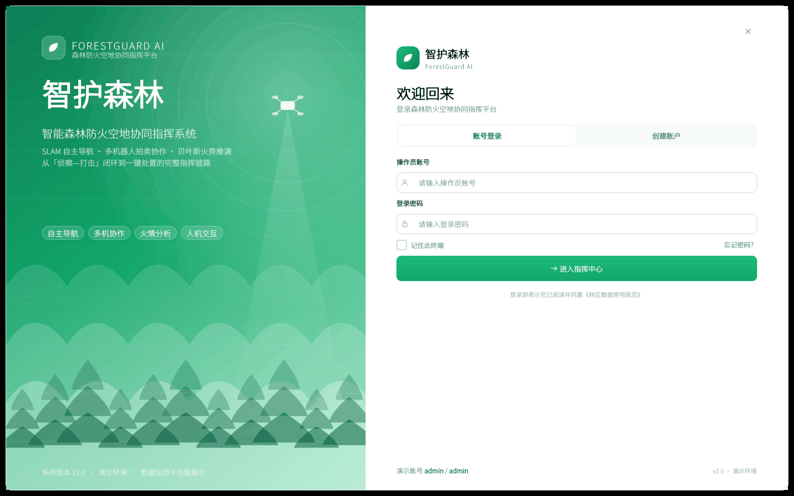
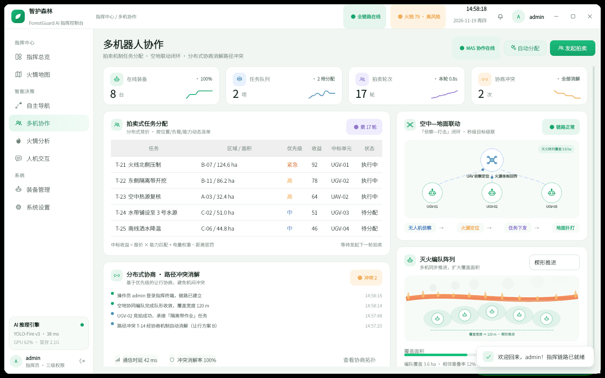
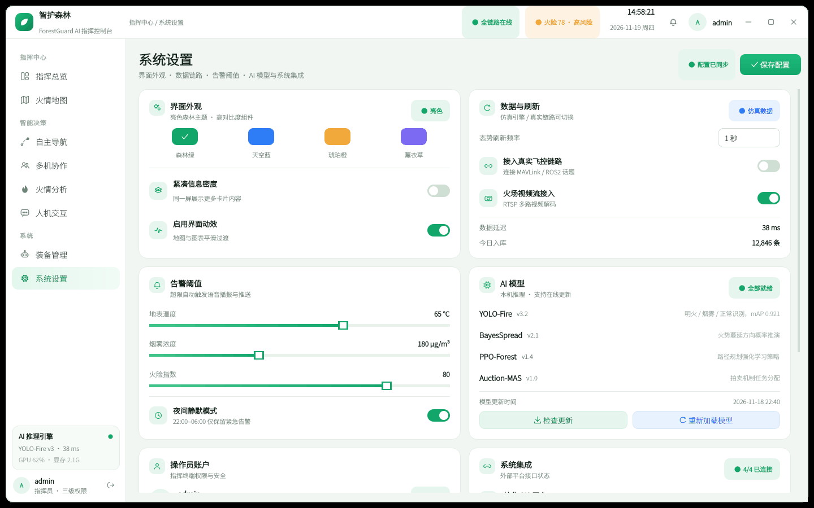
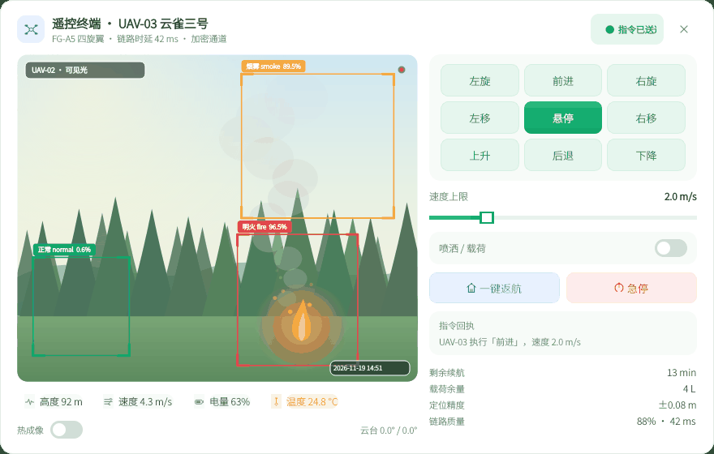

# 智护森林 · ForestGuard AI

> 森林防火空地协同指挥系统 —— 基于 **PySide6 / Qt 6** 的亮色系指挥控制台

面向森林火灾"**侦察 — 决策 — 扑救**"全链路，把 SLAM 自主导航、多机器人拍卖协作、贝叶斯火势推演与语音人机交互整合进同一个指挥界面。
界面采用浅色森林主题（墨绿 + 米白 + 高对比度数据色），所有地图、图表、图标均为 **QPainter 矢量自绘**，不依赖任何外部图片资源。


---

## ✨ 亮点

- **亮色指挥台**：浅色背景 + 森林绿主色，长时间值守不刺眼；卡片、徽标、图表统一设计语言
- **九大页面**：登录、指挥总览、火情地图、自主导航、多机协作、火情分析、人机交互、装备管理、系统设置
- **零图片资源**：60+ 矢量图标、地形底图、热力场、火焰/烟雾、相机画面、波形全部代码绘制
- **可交互仿真内核**：`SimEngine` 以 1 Hz 推进火势、电量、链路与告警，所有按钮都有真实的状态回写
- **一键演示**：`admin / admin` 登录即可完整体验

---

## 🖼 界面预览

| 登录 / 指挥台入口 | 指挥总览 |
| --- | --- |
|  |  |

| 火情态势地图 | 自主导航与路径规划 |
| --- | --- |
|  |  |

| 多机器人协作 | 火情分析与决策 |
| --- | --- |
|  |  |

| 人机交互 | 装备管理 |
| --- | --- |
|  |  |

| 系统设置 | 遥控接管（弹窗） |
| --- | --- |
|  |  |

---

## 🧩 功能模块

### 1. 自主导航与路径规划
- **SLAM 建图**：激光点云 + 视觉融合，关键帧 / 回环、建图进度、点云覆盖率、定位精度实时展示；关键帧与新位姿动态刷新
- **强化学习路径优化**：`RL-A*` 在 A* 代价函数上叠加「火源距离 / 地形坡度 / 风场对齐」三项奖励塑形
- **风场联动**：风向（0–359°）、风速（0–8 m/s）、地形坡度（0–60%）三个滑杆实时重规划，并与常规 A* 做路径长度 / 耗时 / 能耗 / 风险对比
- **动态避险**：最近障碍距离、自动绕行记录、高温阈值（可调）触发急停
- **急停 E-STOP**：一键切换，会写入引擎状态、推送告警、替换按钮样式与图标，可再次恢复

### 2. 多机器人协作
- **拍卖式任务分配**：任务队列按「报价 × 能力匹配 + 电量权重 − 距离惩罚」竞拍，表格展示收益、中标单位与状态
- **空地联动闭环**：UAV 侦察定位 → 火源坐标回传 → 任务下发 → 地面扑打，链路图按阶段高亮
- **编队同步推进**：楔形 / 弧形 / 环形 / 一字阵列可切换，动画演示烟尘与火线
- **分布式协商**：路径冲突按优先级让行，事件流记录协商结果，冲突数归零

### 3. 火情分析
- **多模态识别**：明火 / 烟雾 / 正常环境三分类，置信度进度条 + 检测框可视化，mAP、召回率、误检率
- **可见光 / 热成像**：相机画面双模式，随火势脉动的火焰、上升烟雾柱、扫描线
- **贝叶斯蔓延预测**：风场 / 坡度 / 湿度 / 植被作为证据节点，时间推演滑杆（T+0～T+90）驱动置信热力场
- **灭火策略生成**：建议隔离带走向与宽度、灭火剂配比（水 / 泡沫 / 干粉）、力量编成、处置时序

### 4. 人机交互
- **语音指令**：按住说话、实时波形、唤醒词「智护森林」、6 类快捷指令、识别结果与历史记录
- **指挥终端**：自然语言指令（态势 / 返航 / 喷洒 / 隔离带 / 预案 / 急停）即时解析并回显
- **一键预案**：空地协同压制 / 隔离阻截 / 夜间看守，二次确认后下发；实时态势同步到总览
- **人工干预**：暂停全部任务、全部返航、急停、恢复自动，全部留痕

### 5. 装备管理
- 8 台装备（4 架 UAV + 4 台 UGV）卡片：电量、信号、温度、任务与状态
- 详情面板：电量 / 温度 / 链路三环表、近 10 分钟温度曲线、近期任务履历
- **遥控接管**：方向盘、速度上限、喷洒载荷、返航、急停与指令回执（独立弹窗）
- 批量充电、接入新装备

### 6. 系统设置
- 主题色、信息密度、界面动效
- 数据与刷新：仿真 / 真实链路、刷新频率、MAVLink 接入、RTSP 视频流
- 告警阈值：地表温度、烟雾浓度、火险指数、夜间静默
- AI 模型版本管理、操作员账户、外部平台集成状态

---

## 🛠 技术实现

| 层 | 说明 |
| --- | --- |
| 界面框架 | PySide6 (Qt 6)，`QMainWindow` 自绘标题栏 / 侧边栏，QSS 主题 `app/theme.py` |
| 图形绘制 | `QPainter` 自绘：地形热力场（低分辨率场平滑放大）、火焰/烟雾粒子、检测框、链路图、编队、波形、环形仪表、折线图 |
| 图标系统 | `app/icons.py` 60+ 矢量图标，24×24 设计网格，支持任意颜色与尺寸 |
| 仿真内核 | `app/simulation.py`：`SimEngine`（时钟/告警/事件/拍卖）、`GridPlanner`（A* / Dijkstra / RRT* / RL-A*）、`FireSpreadModel`（椭圆风驱蔓延） |
| 交互 | 信号槽驱动，所有操作实时回写引擎状态并刷新界面；`F11` 最大化、`Esc` 退出最大化 |

### 目录结构

```
ForestGuardAI-System/
├── main.py                   # 程序入口（Fusion + 亮色主题）
├── requirements.txt
├── app/                      # 2.0 亮色指挥台
│   ├── theme.py              # 配色与 QSS
│   ├── icons.py              # 矢量图标
│   ├── widgets.py            # 基础控件（卡片/开关/对话框/toast/环形仪表…）
│   ├── charts.py             # 折线图 / 柱状 / 迷你趋势
│   ├── canvas.py             # 地形图 / 相机画面 / 链路图 / 编队 / 波形
│   ├── simulation.py         # 仿真引擎与算法
│   ├── main_window.py        # 主窗口、标题栏、侧边栏、页面路由
│   └── pages/                # 9 个页面
├── utils/                    # 账号读写（user_data.csv）
├── Gui/                      # 1.x 深色版界面（保留存档）
└── docs/screenshots/         # 界面截图
```

---

## 🚀 快速开始

```bash
git clone https://github.com/Bevis-nb/ForestGuardAI-System.git
cd ForestGuardAI-System
pip install -r requirements.txt
python main.py
```

- 演示账号：**admin / admin**（也可在登录页"创建账户"注册，数据写入 `utils/user_data.csv`）
- 建议分辨率 ≥ 1440×900；支持高分屏缩放
- 可选：安装完整版 `PySide6`（含 QtWebEngine）后可启用"在线卫星底图"

---

## 📌 说明

- 界面中的火情、装备、气象数据均为**仿真数据**，用于功能演示与交互评审
- `Gui/` 目录为 1.x 深色科技风版本，仅作存档，新界面不依赖其中任何资源
- 需求对照：自主导航与路径规划 / 多机器人协作 / 火情分析 / 人机交互，均已落地上屏
